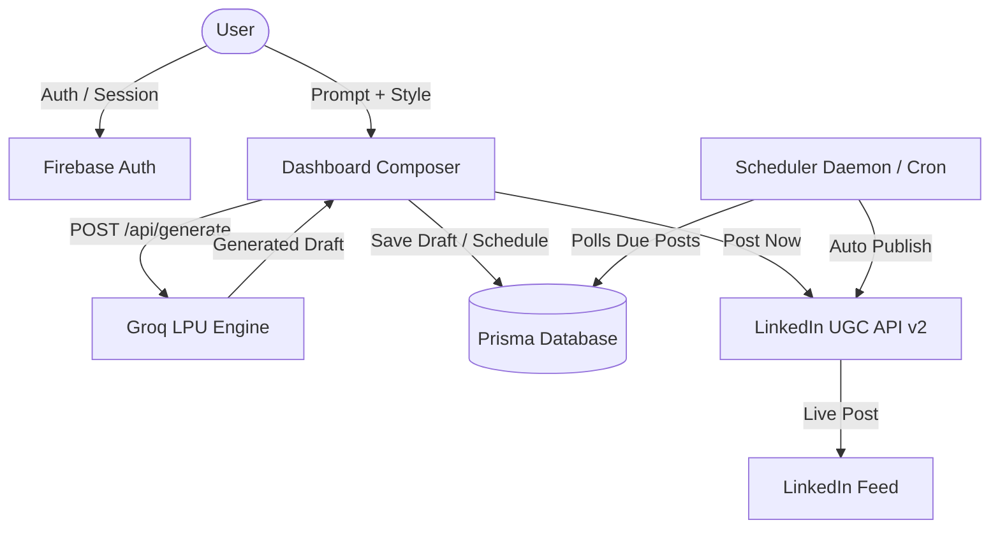

<div align="center">

# ContentMint AI

**AI-powered LinkedIn content operating system for developers, founders, and creators.**  
*Turn rough thoughts into structured posts in under two seconds — draft, schedule, and publish directly to LinkedIn.*

[](https://nextjs.org/)
[](https://www.typescriptlang.org/)
[](https://tailwindcss.com/)
[](https://www.prisma.io/)
[](https://firebase.google.com/)
[](https://groq.com/)

[Features](#key-features) • [Tech Stack](#tech-stack) • [Quickstart](#local-quickstart) • [Architecture](#architecture--data-flow) • [Deployment](#deployment) • [API Routes](#api-routes)

</div>

---

## Key Features

- **5 High-Converting Writing Archetypes**
  - **Story:** Personal narrative, lived lesson, emotional resonance, authentic hook.
  - **Hot Take:** Contrarian perspective, myth-busting, zero corporate jargon.
  - **Framework:** Step-by-step actionable playbook (1, 2, 3), tactical breakdown.
  - **Case Study:** Before vs. after analysis, operational mechanics, measurable ROI.
  - **Insight:** Diamond-sharp 4-line observation with maximum signal-to-noise ratio.
- **Fast AI Generation via Groq LPU**
  - Sub-2 second generation speed.
  - Resilient model fallback: `openai/gpt-oss-120b` -> `openai/gpt-oss-20b` -> `qwen/qwen3.8-27b`.
  - Strict anti-cliche guardrails (bans generic openings like *"In today's fast-paced world"*).
- **Direct LinkedIn Publishing**
  - Official LinkedIn OAuth 2.0 integration (`w_member_social`).
  - Single-click posting directly to your personal LinkedIn profile feed.
  - Smart 429 rate-limit fallback: automatic clipboard copy + opens native LinkedIn compose window.
- **Automated Background Scheduler**
  - Interactive calendar timeline with time-slot pickers.
  - Automated cron processor (`/api/cron/process-scheduled`) publishing due queued posts.
  - Local background runner daemon support.
- **Draft & Content Management**
  - Save, edit, and organize posts in a database-backed drafts workspace.
  - Dual preview: standard feed view and 3-slide carousel breakdown.
- **Full Authentication Suite**
  - Email & password authentication with Firebase.
  - Route guards on `/dashboard/*`, session persistence, and instant logout.

---

## Tech Stack

| Layer | Technologies |
|---|---|
| **Frontend** | Next.js 16 (App Router), React 19, TypeScript, Lucide Icons, Framer Motion |
| **Styling** | Tailwind CSS v4, shadcn/ui design primitives, custom Earthy Botanical dark palette (`#0A0D08`, `#DBCAC0`, `#6F8055`, `#3E4F32`) |
| **Database & ORM** | Prisma ORM with SQLite (local development) / PostgreSQL (production) |
| **Authentication** | Firebase Auth (Client SDK & State Listeners) |
| **AI Inference** | Groq SDK (LPU accelerated models) |
| **Social API** | LinkedIn REST UGC Posts API v2 |

---

## Architecture & Data Flow



---

## Local Quickstart

### 1. Clone the repository
```bash
git clone https://github.com/Sanjay6968/linkend.git
cd linkend
```

### 2. Install dependencies
```bash
npm install
```

### 3. Setup environment variables
Create a `.env.local` file in the root directory:

```env
# Database (Local SQLite)
DATABASE_URL="file:./dev.db"

# Firebase Authentication
NEXT_PUBLIC_FIREBASE_API_KEY="your-firebase-api-key"
NEXT_PUBLIC_FIREBASE_AUTH_DOMAIN="your-app.firebaseapp.com"
NEXT_PUBLIC_FIREBASE_PROJECT_ID="your-project-id"

# Groq AI
GROQ_API_KEY="gsk_your_groq_api_key"

# LinkedIn OAuth 2.0
LINKEDIN_CLIENT_ID="your_linkedin_client_id"
LINKEDIN_CLIENT_SECRET="your_linkedin_client_secret"
LINKEDIN_REDIRECT_URI="http://localhost:3000/api/auth/linkedin/callback"

# App URL
NEXT_PUBLIC_SITE_URL="http://localhost:3000"
```

### 4. Initialize Database
```bash
npx prisma generate
npx prisma db push
```

### 5. Start the Development Server
```bash
npm run dev
```

Visit **[http://localhost:3000](http://localhost:3000)** in your browser.

*(Optional)* Run the local background scheduler in a separate terminal:
```bash
node scheduler-runner.mjs
```

---

## Project Structure

```
├── prisma/
│   ├── dev.db                 # Local SQLite database (gitignored)
│   └── schema.prisma          # Database models (User, Post)
├── public/
│   └── favicon.svg            # Custom SVG icon
├── src/
│   ├── app/
│   │   ├── (auth)/            # Auth routes: Login, Register, Forgot Password
│   │   ├── api/
│   │   │   ├── auth/linkedin/ # OAuth redirect & callback endpoints
│   │   │   ├── cron/          # Scheduled post background worker
│   │   │   ├── generate/      # Groq AI generator with 5 archetypes
│   │   │   ├── linkedin/      # Direct publishing to LinkedIn UGC API
│   │   │   ├── posts/         # Posts CRUD (Drafts & Scheduled)
│   │   │   └── user/status/   # User LinkedIn connection check
│   │   ├── dashboard/
│   │   │   ├── drafts/        # Saved drafts page
│   │   │   ├── schedule/      # Calendar timeline & scheduler
│   │   │   ├── settings/      # Account & LinkedIn integration settings
│   │   │   ├── layout.tsx     # Dashboard layout & route guard
│   │   │   └── page.tsx       # AI Composer workspace
│   │   ├── globals.css        # Theme variables & base typography
│   │   ├── layout.tsx         # Root layout with AuthProvider & metadata
│   │   └── page.tsx           # Landing page
│   ├── components/
│   │   ├── ui/                # UI primitives (Buttons, Cards, Modals, Tabs)
│   │   └── particle-background.tsx
│   ├── hooks/
│   │   └── use-mobile.ts
│   └── lib/
│       ├── firebase/          # Firebase config & AuthContext
│       ├── prisma.ts          # Singleton Prisma client instance
│       └── scheduler.ts       # Scheduled publishing logic
├── scheduler-runner.mjs       # Dev scheduler daemon
├── package.json
└── README.md
```

---

## API Routes Reference

| Route | Method | Description |
|---|---|---|
| `/api/generate` | `POST` | Generates a LinkedIn post based on user prompt and selected style archetype. |
| `/api/posts` | `GET`, `POST`, `DELETE` | CRUD operations for drafts, scheduled posts, and post deletion. |
| `/api/auth/linkedin` | `GET` | Initiates the LinkedIn 3-legged OAuth 2.0 flow. |
| `/api/auth/linkedin/callback` | `GET` | Handles LinkedIn authorization code exchange and stores tokens. |
| `/api/linkedin/publish` | `POST` | Publishes a post directly to the user's LinkedIn profile via UGC API. |
| `/api/cron/process-scheduled` | `GET` | Evaluates due scheduled posts and triggers automated publishing. |
| `/api/user/status` | `GET` | Checks if the current authenticated user has an active LinkedIn integration. |

---

## Deployment

### Deploying to Vercel (with Neon PostgreSQL)

Vercel functions run in a serverless environment with an ephemeral filesystem, requiring a cloud database like **Neon (free tier)**:

1. **Create Database:** Create a free PostgreSQL project at [neon.tech](https://neon.tech).
2. **Update Prisma Schema:** Change `provider = "sqlite"` to `provider = "postgresql"` and add `directUrl = env("DIRECT_URL")` in `prisma/schema.prisma`.
3. **Configure Vercel:**
   - Import your repository on [vercel.com](https://vercel.com).
   - Add all environment variables (with your Neon `DATABASE_URL` and production `LINKEDIN_REDIRECT_URI`).
   - Set Build Command:
     ```bash
     npx prisma generate && npx prisma db push && npm run build
     ```
4. **Update LinkedIn App:** Add your production callback URL `https://your-domain.vercel.app/api/auth/linkedin/callback` under Authorized Redirect URLs in the [LinkedIn Developer Portal](https://www.linkedin.com/developers/apps).

---

## Security & Privacy

- All API secrets (`GROQ_API_KEY`, `LINKEDIN_CLIENT_SECRET`, Firebase credentials) are strictly protected via server-side environment variables and are never exposed to the client bundle.
- User data and post drafts are partitioned by Firebase UID, preventing cross-tenant access.

---

## License

This project is open-source and licensed under the [MIT License](LICENSE).
